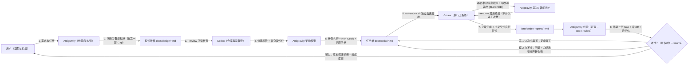

# Antigravity + Codex 协作配置备忘（方案 A · 全局版）

> **核心理念**：代码可以重写，会话可以重开，真正昂贵且稀缺的是**定义系统真相（意图、边界、行为评估、决策溯源）与人的真实理解**。之所以协作，是因为 Codex Token 成本低、仓库分析幻觉少、工程推理严谨，但缺乏“艺术细胞”（UI/UX 审美差、行文晦涩、易过度防御）。因此由 **Antigravity 担任统筹架构师（对齐意图、筛除 Gap、权衡裁剪、审美创意、表达润色、最终验收）**，由 **Codex 担任严谨审查与落地工程师（仓库事实核查、独立代码复审、原子实现、行为测试、修 Bug）**，面向可随时回退的虚拟机开发环境与无人值守长任务。

---

## 一、协作架构与双层判断闭环



### 1. 工程判断与架构可测性的六条核心纪律

| 纪律 | 解决的痛点 | 在本协作体系中的落地机制 |
| :--- | :--- | :--- |
| **双层 Gap 穿透**（Spec / Defaults / Gap） | Agent 私自替人做决定，或无头模式下遇冲突盲猜硬改污染代码 | **对上**：Antigravity 用“三条门槛”区分 Defaults（直接定）与 Gap（先问用户）；**对下**：`run-codex.sh` 对疑问做两级分流——低风险细节自行采用默认方案并单列 **`Unstated Decisions`** 供终验过筛，遇事实硬冲突/越界/高危歧义则零改动停手输出 **`[BLOCKED]`**，由 Antigravity 裁决（或向用户提问）后 `--resume` 续接 |
| **三条门槛筛重留轻** | 什么都记会淹没在噪音里，什么都不记系统会失忆 | 仅当决定满足任一条时才升格为必审 Gap / 必记溯源：① **回退代价高或危险**（钱、数据完整性、删除、安全、对外契约）；② **内行外人看莫名其妙**（魔法数字、反直觉限制）；③ **跨模块边界与数据归属** |
| **骨架先行 + 快慢层分级** | 模块切太碎导致接缝爆炸；底层小改动引发全局故障 | 按“独立变化的决策 + **数据归属**”划边界，多模块先派**最简端到端骨架单（Walking Skeleton）**；区分**快层**（UI/文案）与**慢层**（核心模型、公共契约、换底层库、**删旧功能**），慢层必做前置 `--review` |
| **机器接口先行**（GUI 不复制算法，CLI 是正式机器接口） | 带界面程序让 AI 操控 GUI 或靠多模态截图猜感官效果，慢、脆且难以定量沟通 | 新建带 GUI 项目或新功能/模块时，核心算法必须与 UI 解耦下沉，同步提供无头 CLI / 文件批处理入口并输出 `CSV`/`JSON` 结构化文本，支撑 AI 自动跑通 `修改 → 运行 → 定量评估 → 继续修改` 闭环 |
| **写审分离 + 硬核行为评估** | 写代码的会话顺着原思路自我宽容；绿灯伪测试骗人 | 严禁 Codex 为过测删改/放宽既有测试标准；测试优先测**外部可观测行为**而非绑死私有实现；慢层改动支持 `--code-review` 开启干净只读会话独立挑错 |
| **两次不过止损重开 + 知识搬出会话** | 同一会话反复纠偏残留错误思路，越改越乱；`/compact` 压缩丢失约束 | `--resume` 连续返工**最多 2 次**，仍不过立即仅撤销本任务改动（勿伤用户原有未提交修改）并带教训开全新会话；收尾时将关键决定与**被否决方案及理由**以 3~5 行原地更新至 `AGENTS.md` 或设计稿 |

### 2. 面向 AI 自动评估闭环的双入口架构（GUI + CLI 共核模式）

当前大模型对**结构化文本与数值推理**的理解远强于跨模态看图或操作界面。针对带界面的新建项目、新功能或新模块，架构设计默认遵循 **“核心下沉、双薄壳入口（GUI 面向人交互，CLI 面向 AI 与自动化评估）”**：

* **铁律：GUI 绝不复制算法，CLI 是正式机器接口**——核心业务逻辑与算法下沉至不链接任何图形库（如不引入 Widgets/QML/DOM）的核心层；GUI 与 CLI 作为平级组合根装配同一核心，确保 CLI 测准的行为等价于 GUI 实际运行的行为。
* **两种典型落地形态**：
  1. **无 UI 组合根 CLI**（如协议抓包分析工具中的 `iec104_latency_cli`）：与桌面 GUI 共用 `application/domain` 服务，不链接图形界面库，直接输出流式 `JSON` 结果与确定性退出码；
  2. **离线样本批处理 Runner**（如车载音乐律动项目中的 `mr_file_runner`）：支持直接喂入测试音频并通过 `--config` / `--param key=value` 覆盖参数，调用核心引擎离线导出逐帧 `CSV`（频谱、归一化电平、亮度曲线），把“盯着界面灯带看亮暗变化”的感官玄学转化为基于 `CSV` 数据的定量分析与精确迭代沟通。
* **拆单协同优势**：混合型需求先将 **“核心引擎 + CLI 机器接口 + 定量评估测试”** 作为最简骨架拆给 Codex 高速迭代跑通闭环，最后再由 Antigravity 把控 UI 表现层接入。

### 3. 设计 Review 与“严谨性 vs 可维护性”权衡机制

| Review 意见分级 | 判定标准 | Antigravity 的处理动作 |
| :--- | :--- | :--- |
| **必改项（Adopt）** | 与现有代码库不符的事实偏差、跨边界/数据归属冲突、主路径缺陷、安全或数据一致性风险 | 直接采纳并修订设计方案 |
| **审慎权衡项（Trade-off）** | 极端临界条件、防御式冗余兜底 | 权衡**触发概率与后果** vs **可理解性/可维护性代价**；性价比低时改用清晰的接口契约/前置假设约束 |
| **明确驳回项（Reject）** | 得不偿失的过度防御逻辑或顺手扩范围建议 | 明确不采纳，写入实现任务单 **Non-Goals**，并将重要否决理由原地留痕至设计稿 |

### 4. 规则与配置隔离机制

| 文件 / 目录 | 读取方 | 定位与职责 |
| :--- | :--- | :--- |
| `~/.gemini/GEMINI.md` | **仅 Antigravity** | 全局统筹准则（严格控制在 60 行内）：意图边界、机器接口先行、消除 Gap、快慢层权衡、强制终验与 Git 限制 |
| `~/.gemini/config/skills/codex-executor/` | **仅 Antigravity** | 派单标准 SOP 与封装脚本（不放 `~/.agents/skills/`，避免 Codex 误读） |
| `<repo>/AGENTS.md` | **Antigravity + Codex 共读** | 单仓库持久真相：模块边界与数据归属、构建与行为评估命令、核心不变量与关键决策溯源 |
| `<repo>/.codex/config.toml` 或 `~/.codex/config.toml` | **仅 Codex** | Codex 默认模型、推理强度、MCP 工具等配置 |

### 5. 委派边界（扬长避短）
* **优先派给 Codex**：仓库事实审查、落地后独立代码复审、核心业务逻辑与无头 CLI 机器接口实现、较大重构、多文件修改、行为与定量测试编写、复杂 Bug 定位与修复。
* **由 Antigravity 直接处理、不要交给 Codex**：
  1. **UI/UX 与创意审美类**：界面设计、视觉排版、CSS/样式美学、交互动效、视频生成与动画编排、图表/架构图美化等（前后端/GUI 混合任务将“核心引擎 + CLI 机器接口 + 定量测试”拆给 Codex 跑通闭环，UI 表现层由 Antigravity 把控）；
  2. **文档、文章与交互文案类**：写文档、讲义、文章、调研报告、分析问答与用户交互文案；
  3. **小改动与显式指定**：用户明确要求 Antigravity 直接改代码，或 15 行以内的极小改动（一句话说清的小事直接做，不套重流程）。
* **表达润色与防认知债**：禁止原样生搬 Codex 晦涩生硬的原始报告；面向用户的计划与汇报坚持“简短好读、读完能拍板”，聚焦行为承诺、关键取舍/否决理由与筛出的待拍板项。

---

## 二、已落盘的全局文件清单

1. **全局角色规则**：[`~/.gemini/GEMINI.md`](../antigravity/GEMINI.md)
2. **全局派单 Skill**：[`~/.gemini/config/skills/codex-executor/SKILL.md`](../antigravity/skills/codex-executor/SKILL.md)
3. **全局执行脚本**：[`~/.gemini/config/skills/codex-executor/scripts/run-codex.sh`](../antigravity/skills/codex-executor/scripts/run-codex.sh)
   * 自动补全 `mise` / `~/.local/bin` / `~/.bun/bin` 到 `PATH`；
   * 支持四种模式：编码前 `--review`（只读设计审查）、默认 `exec`（原子任务实现）、`--resume`（`[BLOCKED]` 澄清续接或最多 2 次定向返工）、编码后 `--code-review`（干净会话只读代码复审，写审分离）；
   * 无头疑问两级分流：局部细节单列 `Unstated Decisions`（自行假设），遇事实硬冲突/禁改越界/高危分叉则零改动输出 `[BLOCKED]` 停手待答；明令禁止篡改既有测试标准或自动提交 Git；
   * 自动将报告写入 `/tmp/codex-reports/[review-|code-review-|resume-]<task>-<timestamp>.md`。
4. **自定义底部状态栏**：[`~/.gemini/antigravity-cli/statusline.sh`](../antigravity/statusline.sh)

---

## 三、权限与沙箱配置

### 为什么默认沙箱下无法调用 Codex？
开启 Antigravity 终端沙箱时，存在三重拦截：
1. 宿主机通过 `mise` 管理的 Node 路径（如 `~/.local/share/mise/installs/node/22/bin`）未挂载进沙箱；
2. Codex 凭证与配置目录 `~/.codex` 对沙箱不可见；
3. 沙箱默认断外网，Codex 无法连接 OpenAI API。

### 1. Antigravity 侧（虚拟机最大权限配置）
* **方式 A（持久化，推荐）**：在 Antigravity CLI 中输入 `/config` 或 `/permissions`，将权限预设切换为 **`Turbo`**。
* **方式 B（按会话生效）**：启动 CLI 时携带参数 `agy --dangerously-skip-permissions`。
* **备选（非 VM / 敏感环境）**：保持 `Default` 或 `Auto` 预设，在 `/permissions` 中仅放行 `command(codex exec)`，派单时启用 `--safe`。

### 2. Codex 侧
* **默认（VM 无人值守模式）**：`run-codex.sh` 在 `exec`/`resume` 下附加 `--dangerously-bypass-approvals-and-sandbox`；`--review` 与 `--code-review` 始终强制 `--sandbox read-only`。
* **敏感仓库收紧权限**：加上 `--safe`，自动切换为 `--sandbox workspace-write`。

---

## 四、日常使用速查

### 1. 派单脚本用法
```bash
# 1) 编码前：设计方案只读 Review（常规用 xhigh；复杂架构/慢层改造传 max）
bash ~/.gemini/config/skills/codex-executor/scripts/run-codex.sh --review --effort xhigh <design-doc> [workdir]

# 2) 编码中：派发原子任务单落地实现（一单只做一件事）
bash ~/.gemini/config/skills/codex-executor/scripts/run-codex.sh --effort xhigh <task-file> [workdir]

# 3) 澄清续接或小偏差返工：解答 [BLOCKED] 阻塞问题（不计入熔断），或对代码偏差做定向修复（最多连续 2 次）
bash ~/.gemini/config/skills/codex-executor/scripts/run-codex.sh --resume <session-id> --effort xhigh <clarify-or-rework-file> [workdir]

# 4) 编码后（慢层/高风险改动按需调用）：开启独立干净会话做只读代码复审（写审分离）
bash ~/.gemini/config/skills/codex-executor/scripts/run-codex.sh --code-review --effort xhigh <task-or-design-file> [workdir]

# 5) 敏感仓库安全实现模式（限制在工作区写入）
bash ~/.gemini/config/skills/codex-executor/scripts/run-codex.sh --safe --effort xhigh <task-file> [workdir]
```

> **推理强度分级约定（每次显式传 `--effort`，不假设本地默认值）**：
> * 常规实现、常规升级、常规设计/代码 Review：`--effort xhigh`
> * 复杂架构 Review、慢层高爆炸半径改造、疑难并发 Bug：`--effort max`

### 2. 进入新代码仓库时的最佳实践
1. 用 `templates/AGENTS.md.template` 在仓库根目录建立一页以内的 `AGENTS.md`，写清模块数据归属、行为评估命令、核心不变量与关键决策溯源。
2. 中大型或慢层需求先用 `/plan` 或 `/grill-me` 问清模糊点（消除第一层 Gap），落成短设计稿后跑 `--review`；权衡裁剪后把不做项写入 `Non-Goals`、否决理由留痕设计稿，按“骨架先通、再填细节”拆单派发。
3. 无人值守长任务使用 `/goal`，确保在所有行为评估全部通过前不提前中止。

---

## 五、避坑与版本演进记录

1. **不要再配置旧版 `codex mcp-server`**：OpenAI Codex CLI 自 `v0.154.0` 起已移除该子命令。
2. **不要再用 `--full-auto`**：已弃用，请显式使用 `--sandbox workspace-write` 或 `--dangerously-bypass-approvals-and-sandbox`。
3. **不要把 `codex-executor` 放进 `~/.agents/skills/`**：放在 `~/.gemini/config/skills/` 可确保仅 Antigravity 可见。
4. **状态栏 `/compact` 刷新时机**：Antigravity CLI 执行 `/compact` 刚结束时，`context_window` 仍暂留压缩总结调用本身的用量，待发出下一轮对话消息触发新模型响应后会自动回落更新。

---

## 六、新 VM / 重装环境快速迁移清单

- [ ] 安装并登录 Codex CLI：`npm install -g @openai/codex && codex login`
- [ ] 克隆本仓库并执行 `./install.sh` 建立软链接
- [ ] 在 `~/.gemini/antigravity-cli/settings.json` 中按需启用 `statusLine`（参考 `examples/antigravity.settings.json.example`）
- [ ] 在 Antigravity CLI 中执行 `/config` 将权限预设设为 `Turbo`（或使用 `agy --dangerously-skip-permissions` 启动）
- [ ] 重启一次 `agy` 会话，验证 `codex --version` 正常输出即可投入使用
