# Antigravity + Codex 协作配置备忘（方案 A · 全局版）

> **核心理念**：之所以协作，是因为 Codex Token 成本低、代码落地与工程推理严谨，但没有“艺术细胞”（UI/UX 审美差、行文晦涩、易过度防御）。因此由 **Antigravity 担任架构师 / 统筹者（设计、权衡、审美创意、表达润色、最终验收）**，由 **Codex 担任执行工程师（仓库事实审查、写代码、重构、补单测、修 Bug）**，面向可随时回退的虚拟机开发环境与无人值守长任务。

---

## 一、协作架构与角色分工

```mermaid
flowchart LR
    U["用户需求"] --> A["Antigravity（统筹/架构师）"]
    A -->|"1. 输出设计方案"| D["设计稿 docs/design/*.md"]
    D -->|"2. --review 只读审查"| CR["Codex（仓库事实核查）"]
    CR -->|"3. 分级反馈（含复杂度代价）"| W["Antigravity 架构权衡"]
    W -->|"4. 修订方案 + 明确 Non-Goals + 拆原子单"| T["任务单 docs/tasks/*.md"]
    T -->|"5. run-codex.sh 派单落地"| C["Codex（执行工程师）"]
    C -->|"6. 改代码 + 跑测试 + 写报告"| R["/tmp/codex-reports/*.md"]
    R --> A2["Antigravity 终验"]
    A2 -->|"7. git diff（防过度防御）+ 亲自跑测试"| V{"验收通过？"}
    V -->|"否：整理问题返工"| T
    V -->|"是：汇报交付与关键取舍"| U
```



### 设计 Review 与“严谨性 vs 可维护性”权衡机制

Codex 对真实代码仓库的分析幻觉少、疏漏少，但容易对极端临界情况提出**大量防御式编程**建议。因此流程中采用“**先让 Codex 严审，再由 Antigravity 理性裁剪**”的双重把关：

| Review 意见分级 | 判定标准 | Antigravity 的处理动作 |
| :--- | :--- | :--- |
| **必改项（Adopt）** | 与现有代码库不符的事实偏差、接口/依赖冲突、主路径缺陷、安全或数据一致性风险 | 直接采纳并修订设计方案 |
| **审慎权衡项（Trade-off）** | 极端临界条件、防御式冗余兜底 | 权衡**触发概率与后果** vs **代码复杂度/可维护性代价**；性价比低时改用清晰的接口契约/前置假设约束 |
| **明确驳回项（Reject）** | 得不偿失的过度防御逻辑 | 明确不采纳，并写入实现任务单的 **Non-Goals**，防止 Codex 在编码阶段自行补回防御代码 |

### 规则与配置隔离机制

| 文件 / 目录 | 读取方 | 定位与职责 |
| :--- | :--- | :--- |
| `~/.gemini/GEMINI.md` | **仅 Antigravity** | 全局角色边界：统筹设计、何时委派 Codex、强制验收闭环 |
| `~/.gemini/config/skills/codex-executor/` | **仅 Antigravity** | 派单标准 SOP 与封装脚本（不放 `~/.agents/skills/`，避免 Codex 误读） |
| `<repo>/AGENTS.md` | **Antigravity + Codex 共读** | 单仓库技术真相：目录结构、技术栈、编码规范、构建与测试命令 |
| `<repo>/.codex/config.toml` 或 `~/.codex/config.toml` | **仅 Codex** | Codex 默认模型、推理强度、MCP 工具等配置 |

### 委派边界（扬长避短，避免机械派单）
* **优先派给 Codex**：仓库事实审查、核心业务逻辑实现、较大重构、多文件修改、单测编写、复杂 Bug 定位与修复。
* **由 Antigravity 直接处理、不要交给 Codex**：
  1. **UI/UX 与创意审美类**：界面设计、视觉排版、CSS/样式美学、交互动效、视频生成与动画编排、图表/架构图美化等（混合型前端任务仅将纯逻辑/接口/单测拆给 Codex，UI 表现层由 Antigravity 把控）；
  2. **文档、文章与交互文案类**：写文档、讲义、文章、调研报告、分析问答与用户交互文案；
  3. **小改动与显式指定**：用户明确要求 Antigravity 直接改代码，或 15 行以内的极小改动（小修配置、补注释、改单行参数）。
* **表达润色把关**：Codex 原始反馈往往用词晦涩、可读性差。凡需面向用户呈现的 Review 结论、执行汇报、文档或交互内容，一律由 Antigravity 梳理、提炼并润色后再输出，不原样生搬。

---

## 二、已落盘的全局文件清单

以下 3 个全局文件均已创建并已验证被 Antigravity 正常加载生效：

1. **全局角色规则**：[`~/.gemini/GEMINI.md`](../antigravity/GEMINI.md)
   * 对所有工作区生效，确立“统筹设计 + Codex 前置只读 Review + 架构权衡（防过度防御编程）+ 派单落地 + `git diff`/测试验收闭环”的默认协作方式。
2. **全局派单 Skill**：[`~/.gemini/config/skills/codex-executor/SKILL.md`](../antigravity/skills/codex-executor/SKILL.md)
   * 按需激活（Progressive Disclosure），规范 5 步 SOP：检查/建立 `AGENTS.md` → `--review` 设计前置只读审查与权衡裁剪 → 编写带 `Non-Goals` 的原子任务单 → 调用脚本派发 Codex → 读报告 + 审查 `git diff`（兼查冗余防御代码）+ 亲自跑验收命令。
3. **全局执行脚本**：[`~/.gemini/config/skills/codex-executor/scripts/run-codex.sh`](../antigravity/skills/codex-executor/scripts/run-codex.sh)
   * 自动补全 `mise` / `~/.local/bin` / `~/.bun/bin` 到 `PATH`，解决非登录 shell 找不到 `codex` 的问题；
   * 支持 **`--review` 只读设计审查模式**（强制 `--sandbox read-only`，要求 Codex 按严重级别分组并标注触发概率与复杂度代价）；
   * 自动将报告写入带时间戳的独立文件 `/tmp/codex-reports/[review-]<task>-<timestamp>.md`；
   * 实现模式默认适配 VM 无人值守全自动，支持 `--safe` 与 `--model` 参数。

---

## 三、权限与沙箱配置

### 为什么默认沙箱下无法调用 Codex？
开启 Antigravity 终端沙箱时，存在三重拦截：
1. 宿主机通过 `mise` 管理的 Node 路径（如 `~/.local/share/mise/installs/node/22/bin`）未挂载进沙箱；
2. Codex 凭证与配置目录 `~/.codex` 对沙箱不可见；
3. 沙箱默认断外网，Codex 无法连接 OpenAI API。

### 1. Antigravity 侧（虚拟机最大权限配置）

* **方式 A（持久化，推荐）**：
  在 Antigravity CLI 中输入 `/config` 或 `/permissions`，将权限预设切换为 **`Turbo`**。
  * 效果：关闭终端沙箱（`enableTerminalSandbox: false`），免确认放行终端命令、全文件系统读写及工具调用。
* **方式 B（按会话生效）**：
  启动 CLI 时直接携带参数：
  ```bash
  agy --dangerously-skip-permissions
  ```
* **备选（若后续迁到非 VM / 敏感环境）**：
  保持 `Default` 或 `Auto` 预设，在 `/permissions` 中仅添加 `allow` 规则放行 `command(codex exec)`（或对应封装脚本），同时在派单时启用 `--safe`。

### 2. Codex 侧

* **默认（VM 无人值守模式）**：`run-codex.sh` 自动附加 `--dangerously-bypass-approvals-and-sandbox`，跳过审批弹窗并解除 Codex 内置沙箱，避免安装依赖、联网或跑集成测试时中途卡死。
* **敏感仓库收紧权限**：调用脚本时加上 `--safe`，自动切换为 `--sandbox workspace-write`，将 Codex 写入权限限制在当前工作区内。
* **默认模型配置（可选）**：在 `~/.codex/config.toml` 中设置常用模型与推理强度。

---

## 四、日常使用速查

### 1. 派单脚本用法
```bash
# 设计方案前置只读 Review（常规设计用 --effort xhigh；复杂架构显式传 --effort max）
bash ~/.gemini/config/skills/codex-executor/scripts/run-codex.sh --review --effort xhigh <design-doc> [workdir]

# 默认实现模式（VM 无沙箱全自动；常规实现/常规升级用 xhigh，疑难 Bug 显式传 max）
bash ~/.gemini/config/skills/codex-executor/scripts/run-codex.sh --effort xhigh <task-file> [workdir]

# 验收不通过时续接上次会话定向返工（复制上次输出里的 session id）
bash ~/.gemini/config/skills/codex-executor/scripts/run-codex.sh --resume <session-id> --effort xhigh <rework-file> [workdir]

# 敏感仓库安全实现模式（限制在工作区写入）
bash ~/.gemini/config/skills/codex-executor/scripts/run-codex.sh --safe --effort xhigh <task-file> [workdir]

# 临时指定 Codex 模型（可与 --review / --resume / --safe / --effort 组合）
bash ~/.gemini/config/skills/codex-executor/scripts/run-codex.sh --model <model-name> --effort max <task-file> [workdir]
```

执行输出中会打印：
* `MODE=review|exec|resume`：本次执行模式
* `WORKDIR=...`：实际执行仓库目录（非 Git 目录会自动附加 `--skip-git-repo-check`）
* `TASK_FILE=...`：本次设计稿、任务单或返工说明路径
* `REPORT_FILE=/tmp/codex-reports/[review-|resume-]<slug>-<timestamp>.md`：Codex 最终审查或实现汇报文件
* Codex 头部中的 `session id: <uuid>`：返工时可直接传给 `--resume` 复用上下文

> **推理强度分级约定（每次显式传 `--effort`，不假设本地默认值）**：
> * 常规实现、常规升级、常规设计 Review：`--effort xhigh`
> * 复杂架构设计 Review、高风险改造、疑难 Bug：`--effort max`

### 2. 进入新代码仓库时的最佳实践
1. 在仓库根目录维护一份精简的 `AGENTS.md`（目录结构、技术栈、构建/单测/Lint 命令、禁改区域），确保 Antigravity 与 Codex 对齐同一套上下文。
2. 复杂需求先使用 `/plan` 出分步计划，或用 `/grill-me` 追问清边界，产出设计方案后先跑 `--review` 让 Codex 对照真实代码库严审；Antigravity 权衡取舍后，再把确定**不做过度防御**的条目写进任务单 `Non-Goals`，拆成原子任务单（建议放 `docs/tasks/<id>.md` 或临时放 `/tmp/codex-tasks/`）。
3. 无人值守长任务使用 `/goal`，确保在所有验收测试全部通过前不提前中止。

---

## 五、避坑与版本演进记录

1. **不要再配置旧版 `codex mcp-server`**
   * OpenAI Codex CLI 自 2026 年 9 月（`v0.154.0` 起）已正式移除 `codex mcp-server` 子命令，旧配置会报错或挂起。
   * 若未来需要升级到**方案 B**（通过 MCP 复用 Codex `thread_id` 做多轮连续返工），应基于 `@openai/codex-sdk` 或 `codex app-server` 编写轻量 Stdio MCP 桥接服务，注册到 `~/.gemini/config/mcp_config.json`。
2. **不要再用 `--full-auto`**
   * 新版 Codex CLI 已弃用 `--full-auto`；请显式使用 `--sandbox workspace-write`（安全模式）或 `--dangerously-bypass-approvals-and-sandbox`（隔离 VM 全自动模式）。
3. **不要把 `codex-executor` 放进 `~/.agents/skills/`**
   * `~/.agents/skills/` 可能被其他 Agent 工具共同扫描；放在 `~/.gemini/config/skills/` 可确保仅 Antigravity 可见。

---

## 六、新 VM / 重装环境快速迁移清单

- [ ] 安装并登录 Codex CLI：`npm install -g @openai/codex && codex login`
- [ ] 恢复全局规则：`~/.gemini/GEMINI.md`
- [ ] 恢复全局 Skill 与脚本：`~/.gemini/config/skills/codex-executor/SKILL.md`、`scripts/run-codex.sh`
- [ ] 在 Antigravity CLI 中执行 `/config` 将权限预设设为 `Turbo`（或使用 `agy --dangerously-skip-permissions` 启动）
- [ ] 重启一次 `agy` 会话，验证 `codex --version` 正常输出即可投入使用
